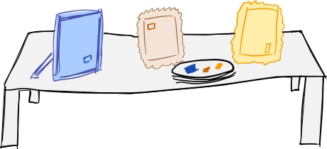

# Frame Buffet - all you can treat!

[](LICENSE.md)
[](https://codeberg.org/dneuge/framebuffet/issues)



Frame Buffet is a library implementing an externally configurable modular 2D scene graph for frame buffer composition. The project's goals are:

* a light-weight and easy-to-use framework, written in C to be as universally reusable as possible
* image sources/generation as well as processing should be fully modular for easy customization/extension
  * all modules should be optional
* use as little runtime dependencies as possible (unless required by a specific source module)
* suitable both for dynamic and static linking
* the library should be as platform-independent as possible, supporting all major operating systems

Official repositories are hosted on [Codeberg](https://codeberg.org/dneuge/framebuffet) and [GitHub](https://github.com/dneuge/framebuffet). Both locations are kept in sync and can be used to submit pull requests but issues are only tracked on [Codeberg](https://codeberg.org/dneuge/framebuffet/issues) to gather them in a single place. Please note that [all contributions](CONTRIBUTING.md) incl. issue reports are subject to a restrictive [AI Usage Policy](AI_USAGE_POLICY.md).

## Current state

The framework is in early development. The API is *not stable* yet and may change at any time without notice.

### Included modules

The following modules are included with the current version of Frame Buffet:

* platform-independent:
  * [`crop`](fbsources/crop) extracts a rectangular part from another source
  * [`dummy`](fbsources/dummy) generates a simple animated color pattern for debugging, also useful as a reference when writing custom modules
  * [`libvnc`](fbsources/libvnc) uses [LibVNC](https://github.com/LibVNC/libvncserver) to connect to a VNC server (note that LibVNC is [licensed GPL 2](https://github.com/LibVNC/libvncserver/blob/master/COPYING))
  * [`merge`](fbsources/merge) combines rectangular parts from other sources
* platform-dependent:
  * [`capture_x11`](fbsources/capture_x11) implements screen capture on Linux for X11

Additional screen capture modules for Windows and the macOS® operating system are expected to be added H1/2026. A screen capture module for Wayland will eventually become necessary as well but has lower priority as [the X11 module](fbsources/capture_x11) can be used (with some reliability issues) in the mean-time.

### Framework bindings

The following projects provide bindings for the framework:

* Java: [JNA Java bindings for Frame Buffet](https://codeberg.org/dneuge/framebuffet-jna) (available on [Codeberg](https://codeberg.org/dneuge/framebuffet-jna) and [GitHub](https://github.com/dneuge/framebuffet-jna))

## History

For another project I needed a way to merge a frame buffer image from several sources which again needed to be split up and potentially transformed somehow. This all should happen multi-threaded (one of the sources being a network stream via VNC) with as low latency as possible. The end consumer (a rendering phase callback) should not have to wait for the image to be composed but just grab whatever the compositing had previously completed to keep the callback runtime as short as possible (and thus not negatively influence the application's framerate). The sources I was about to grab from had to be configurable and there had to be user-configurable variables to do system-specific image manipulation (splitting). I also wasn't sure about the exact details of the source images either. In the end I figured that if I already have a framework allowing me to configure such modular scene graphs, then I might even want to add some image generation as frame buffer sources instead of post-processing the composited frames with an overlay afterwards. Oh, and everything had to be statically linkable. Since an Internet search didn't turn up any such library I decided to implement it separate from the original project I needed it for as it might be useful for other projects.

## How to build

Builds are supported on Linux, the macOS® operating system and Windows (only using Visual Studio on CLI with Git bash, see below), with cross-compilation support from Linux for Windows using MinGW.

Environment variables `CC` (to select a C compiler) and `CPP_COMPILER` (to select a C++ compiler) are honored and can be used to override automated compiler selection. If not set, Linux builds will be compiled using Clang or GCC, if Clang is unavailable. When targeting Windows, MinGW will be used when compiling on Linux.

By default, build scripts will attempt to detect the number of CPUs and use all + 1 for compilation (except if anything needs to be built single-threaded). Environment variable `NUM_CPUS` can be used to override auto-detection - setting it to `0` will force single-thread compilation which works around Clang compiler messages being garbled up when printed concurrently.

Visual Studio is only supported for compilation of Windows binaries on CLI, but (at least currently) not for development. The main purpose is to enable builds on CI platforms which may offer more trouble-free license conditions than MinGW, although native C11 thread support and much smaller binaries are also a nice side-effect. Builds using Visual Studio are, as unconventional as it may be, performed using the same build scripts written for Bash. The easiest way is to install the official Git distribution for Windows which includes "Git Bash". Most CI providers usually have such environments already included in their standard images.

### Prerequisites

Build scripts require a Bash shell and assume a Linux/Unix-like environment. If you are on Windows, you will probably want to use a VM, WSL, Docker container or similar. Visual Studio builds can be performed using Git Bash or similar (see above).

A recommended [`Dockerfile`](container/build-ubuntu22.04) based on Ubuntu 22.04 is included within this repository and can be used as a base for customized images.

Compilation with Clang (17 or later) is recommended but GCC and MinGW (to target Windows) should work as well. Note that the compiler and its environment may have an impact on licensing terms when distributing binaries. Proper licensing is the sole responsibility of developers using this library in their projects; this project cannot (and will not) give any advice in that regard.

The macOS® operating system can only be targeted using the Xcode® development suite on a genuine Mac® computer. Cross-compilation support from other platforms will not be supported and shall not be discussed unless officially approved by Apple Inc.

Some modules require external dependencies which can be downloaded and built (confined to the project) automatically as described below. Linux modules also require X11 dependencies to be globally available on the build environment.

#### Old Clang incompatibility

Clang before version 17 cannot be used to build source modules as it does not regard constant function references as compile-time constants.
Compilation will abort with the following error which appears to have been a compiler bug which is fixed in Clang 17 and later:

```
error: initializer element is not a compile-time constant
FBSOURCE_MODULE_DESCRIPTOR(dummy, "Dummy", FBMODULE_LICENSE_MIT, dummy_module)
                                                                 ^~~~~~~~~~~~
note: expanded from macro 'FBSOURCE_MODULE_DESCRIPTOR'
        .ops = moduleops                                                \
               ^~~~~~~~~
```

#### C11 Threads support

Frame Buffet relies on C11 Threads. Unfortunately, as of late 2025, some environments still do not support those, so wrappers are used if necessary:

- C11 Threads are natively supported (no wrapper required) when targeting Linux (either with GCC or Clang) or when using a recent Visual Studio to target Windows 10 or later.
- The macOS® operating system only supports POSIX Threads without wrapping C11 Threads on its own, so a [wrapper](https://github.com/dneuge/c11-threads-compat-for-macos-operating-system) included within this project is being used to supplement the missing translations.
- MinGW currently does not have the bindings necessary to access C11 Thread support in Windows (e.g. for cross-compilation from Linux). By default, a wrapper extracted from [Mesa](https://mesa3d.org) is used instead.

The wrappers included with Frame Buffet may cause issues when integrating the library into projects that also rely on C11 Threads but use different wrappers. It may be necessary to unify all modules to use a single common wrapper implementation instead when encountering ambiguous symbol references/confusion of wrapper implementations. This also means that, although generally supported, compilation with **MinGW is not recommended** to avoid compatibility issues and overly complex build setups.

### Build scripts

To build the plugin execute the following scripts in sequence, as needed:

* [`fetch-libs.sh`](fetch-libs.sh) downloads (and verifies) external dependencies from the Internet into the `lib` directory
* [`build-libs.sh`](build-libs.sh) builds the external dependencies
* [`build.sh`](build.sh) builds the framework incl. all modules
  * [`tools/fbsourceviewer`](tools/fbsourceviewer) will only get built if SDL2 has been installed globally on the host system; only tested on Linux

You may also find [`do_all.sh`](do_all.sh) useful which runs all these commands in sequence.

#### Environment variables

The build scripts support some optional environment variables:

| Script | Variable | Effect |
| ------ | -------- | ------ |
| `fetch-libs.sh` | `FBFETCHLIBS_DOWNLOAD_ONLY=1` | files will only be downloaded, not extracted (useful for CI cache updates) |
| `build-libs.sh` | `FBBUILDLIBS_KEEP_BUILD=1` | dependency build target directory `lib/_build` will not be deleted (useful for inclusion to other projects) |
| `build-libs.sh`, `build.sh` | `NUM_CPUS` | overrides automatically detected number of CPUs to use, set to `0` to force single-threaded compilation |

## How to develop

Frame buffer source modules are separate dynamically linkable libraries (.so/.dll). Please refer to [`fbsources`](fbsources) for the modules currently included in this repository. 

You may find [`tools/fbsourceviewer`](tools/fbsourceviewer) useful for manual testing.

## Security

Please refer to the [security policy](SECURITY.md) for details on how to report security issues and an overview of security considerations.

## License

The source code and accompanying files are released under [MIT license](LICENSE.md) unless stated otherwise. The framework does not depend on any dependencies that would restrict the license.

**Note that modules can use external dependencies which may have different licenses.** The MIT license is flexible enough to allow interfacing with different licenses but as a result the **compiled binaries may require distribution under multiple/different licenses** and **at runtime licenses may change depending on loaded modules**.

Please check modules for all applicable licenses before use or redistribution.

### Major inclusions

Due to a lack of knowledge (and documentation) about Windows programming, capturing on Windows (`capture_winrt_dxgi`)
would not have been possible to implement without *closely* following/translating the following projects by
Robert Mikhayelyan, with the Windows-binding parts of the Frame Buffet source module effectively being derivatives
of those projects:

- https://github.com/robmikh/Win32CaptureSample, licensed MIT, Copyright (c) 2019 Robert Mikhayelyan
- https://github.com/robmikh/robmikh.common, licensed MIT, Copyright (c) 2019 Robert Mikhayelyan

### Note on the use of/for AI

Usage for AI training is subject to individual source licenses, there is no exception. This generally means that proper
attribution must be given and disclaimers may need to be retained when reproducing relevant portions of training data.
When incorporating source code, AI models generally become derived projects. As such, they remain subject to the
requirements set out by individual licenses associated with the input used during training. When in doubt, all files
shall be regarded as proprietary until clarified.

Unless you can comply with the licenses of this project you obviously are not permitted to use it for your AI training
set. Although it may not be required by those licenses, you are additionally asked to make your AI model publicly
available under an open license and for free, to play fair and contribute back to the open community you take from.

For contributions to this project, **AI tools and services may only be used as detailed in the
[Contribution Guidelines](CONTRIBUTING.md) and separate [AI Usage Policy](AI_USAGE_POLICY.md)**. Contributors will be
asked to confirm and permanently record compliance with that policy. Violations may lead to immediate and permanent
removal from this project, depending on severity.

## Acknowledgements

Mac, macOS and Xcode are trademarks of Apple Inc., registered in the U.S. and other countries and regions.
